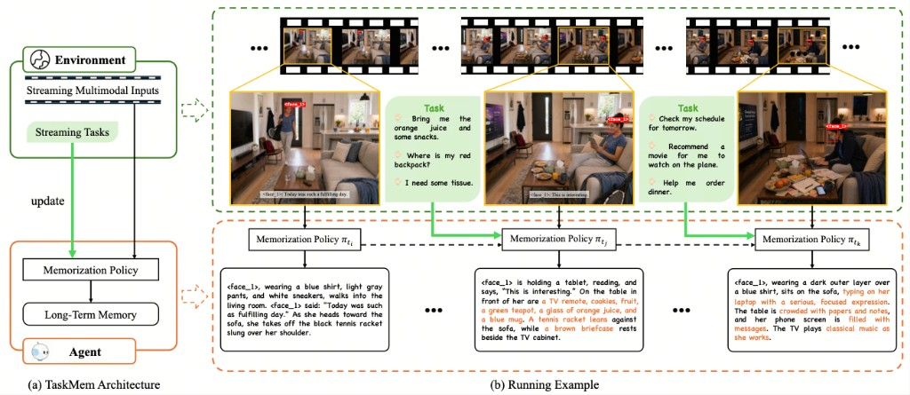
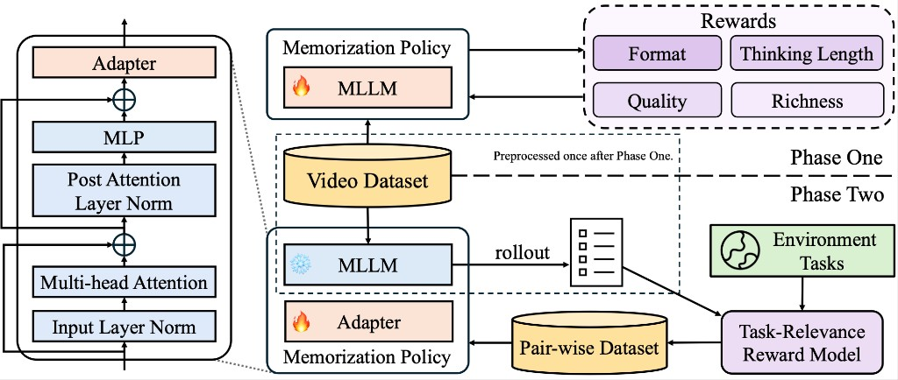

# Task-Focused Memorization for Multimodal Agents

[arXiv](https://arxiv.org/pdf/2605.31075) | [Demo](https://hope-rita.github.io/TaskMem-demo/) | [Model](https://huggingface.co/ByteDance-Seed/TaskMem) | [Phase One](https://github.com/Hope-Rita/TaskMem-PhaseOne)

> This repository is the **inference framework** of TaskMem: it streams a
> video clip-by-clip, builds episodic long-term memory, and runs
> streaming-memory QA evaluation against an off-the-shelf VLM. Training of
> the base memorization policy is released as the companion repository
> [**TaskMem-PhaseOne**](https://github.com/Hope-Rita/TaskMem-PhaseOne).



> **(a) TaskMem Architecture.** An agent receives streaming multimodal
> inputs and streaming tasks from the environment, and continually updates
> its long-term memory through a learned **memorization policy**.
> **(b) Running Example.** Tasks arriving at different time steps shift
> the focus of the memorization policy
> $\pi_{t_i} \to \pi_{t_j} \to \pi_{t_k}$, so the same scene is
> memorized in different ways depending on what the agent will be asked.

## Abstract

Long-term memory is essential for multimodal agents to build coherent experience, accumulate world knowledge, and achieve continual learning. However, constructing effective memory goes beyond memory module design and basic requirements such as accuracy and fidelity; the key challenge lies in determining **what to memorize**. Multimodal agents, such as embodied agents, continuously perceive, reason, and act in real or virtual environments, receiving an unbounded stream of multimodal observations. From this combinatorial explosion of information, an agent must selectively retain content that is relevant to its role in the environment and valuable for future tasks. To bridge this gap, we frame memory generation as a learnable memorization policy and introduce **TaskMem (Task-focused Memorization Policy Learning)**, a reinforcement-learning-based framework that enables the policy to dynamically adjust its focus to the demands of real tasks encountered in the environment. TaskMem adopts a two-phase training paradigm: **Phase One** learns *how* to memorize by optimizing memory quality under fundamental fidelity requirements; **Phase Two** occurs after deployment, where the agent learns *what* to memorize by tuning an adapter on its base MLLM, using recent environment tasks to define a reward model that guides the memorization policy toward task-relevant content. To evaluate our approach, we reformulate VideoMME, EgoLife, and EgoTempo into **streaming benchmarks** that simulate a realistic setting in which an agent processes streaming observations and handles tasks arriving online. To isolate memory assessment, the questions must be answered using only the agent's memory, without access to raw video. Built on **Qwen3-VL-30B-A3B**, TaskMem improves VQA accuracy by **6.3%**, **7.0%**, and **5.3%** on these benchmarks, respectively.

## Method



> **Phase One** trains the memorization policy on a frozen video dataset
> against fidelity-style rewards — **Format**, **Thinking Length**,
> **Quality** and **Richness** — to learn *how* to memorize.
> A subsequent task-relevance phase adapts the policy to specific
> deployment tasks; see the [paper](https://arxiv.org/pdf/2605.31075) for
> details.

## Experimental Results

<table>
  <thead>
    <tr>
      <th rowspan="2">Method</th>
      <th colspan="3" align="center">Video-MME</th>
      <th colspan="3" align="center">EgoLife</th>
      <th colspan="3" align="center">EgoTempo</th>
    </tr>
    <tr>
      <th align="right">Acc.</th><th align="right">Cov.</th><th align="right">Prec.</th>
      <th align="right">Acc.</th><th align="right">Cov.</th><th align="right">Prec.</th>
      <th align="right">Acc.</th><th align="right">Cov.</th><th align="right">Prec.</th>
    </tr>
  </thead>
  <tbody>
    <tr><td>EgoGPT</td>           <td align="right">44.3</td><td align="right">58.7</td><td align="right">75.5</td><td align="right">19.2</td><td align="right">28.2</td><td align="right">68.1</td><td align="right">15.0</td><td align="right">33.5</td><td align="right">44.9</td></tr>
    <tr><td>HippoMM</td>          <td align="right">48.9</td><td align="right">66.6</td><td align="right">73.5</td><td align="right">30.4</td><td align="right">43.4</td><td align="right">70.0</td><td align="right">15.8</td><td align="right">30.8</td><td align="right">51.1</td></tr>
    <tr><td>M3-Agent</td>         <td align="right">62.5</td><td align="right">77.7</td><td align="right">80.4</td><td align="right">21.8</td><td align="right">30.8</td><td align="right">70.8</td><td align="right">16.0</td><td align="right">36.3</td><td align="right">44.2</td></tr>
    <tr><td>Gemini-1.5-Pro</td>   <td align="right">55.3</td><td align="right">65.9</td><td align="right">83.9</td><td align="right">39.4</td><td align="right">51.6</td><td align="right">76.4</td><td align="right">19.7</td><td align="right">34.3</td><td align="right">57.4</td></tr>
    <tr><td>Gemini-2.5-Pro</td>   <td align="right">63.2</td><td align="right">74.8</td><td align="right">84.4</td><td align="right">43.8</td><td align="right">56.6</td><td align="right">77.4</td><td align="right">25.8</td><td align="right">42.3</td><td align="right">61.0</td></tr>
    <tr><td>GPT-5.2</td>          <td align="right">67.3</td><td align="right">80.8</td><td align="right">83.3</td><td align="right">34.8</td><td align="right">48.2</td><td align="right">72.2</td><td align="right"><b>32.1</b></td><td align="right">51.4</td><td align="right">62.4</td></tr>
    <tr><td>Qwen3-VL-30B-A3B</td> <td align="right">61.6</td><td align="right">74.7</td><td align="right">82.5</td><td align="right">38.4</td><td align="right">52.4</td><td align="right">73.3</td><td align="right">22.3</td><td align="right">38.9</td><td align="right">57.2</td></tr>
    <tr><td><b>TaskMem (Ours)</b></td><td align="right"><b>67.9</b></td><td align="right">79.3</td><td align="right"><b>85.6</b></td><td align="right"><b>45.4</b></td><td align="right">56.4</td><td align="right"><b>80.5</b></td><td align="right">27.6</td><td align="right">43.7</td><td align="right"><b>63.2</b></td></tr>
  </tbody>
</table>

See the [project page](https://hope-rita.github.io/TaskMem-demo/) for the
full table and a live demo.

## Run Locally (Inference)

This repository runs the **memorization pipeline at inference time**: it
takes a raw video, streams it clip-by-clip, and builds an episodic
long-term memory that downstream QA can consume. The episodic step is
driven by an off-the-shelf VLM (Gemini / GPT API or vanilla Qwen3-VL via
local vLLM), or by our released **Phase-One** TaskMem checkpoint on
Hugging Face ([`ByteDance-Seed/TaskMem`](https://huggingface.co/ByteDance-Seed/TaskMem)),
loadable through the same `qwen3_vl_vllm` backend by passing it as
`--episodic_model_path`.

### 1. Install

```bash
git clone https://github.com/ByteDance-Seed/TaskMem.git
cd TaskMem
bash setup.sh
```

`bash setup.sh` installs the Python deps (`moviepy`, `pydub`,
`hdbscan`, `insightface`, `json-repair`, `openai`) plus the `ffmpeg`
system package. The Gemini / GPT default path does not need vLLM.
If you want to use the optional local Qwen3-VL episodic backend
(`qwen3_vl_vllm`), install `vllm` and `qwen-vl-utils` separately.

### 2. Configure the LLM judge

Copy the template, fill in your credentials, and point
`TASKMEM_API_CONFIG` at it:

```bash
cp configs/api_config.json configs/api_config.local.json
export TASKMEM_API_CONFIG=configs/api_config.local.json
```

Required because the default ASR / voice / episodic backends are all
Gemini, and because all QA evaluation scripts call an LLM judge.

### 3. Run the pipeline

End-to-end on a single video:

```bash
export VIDEO_PATH=./data/videos/demo.mp4
export OUTPUT_FOLDER=./out/demo

# Default: Gemini for ASR / voice / episodic. API-only, no GPU required;
# expects TASKMEM_API_CONFIG to be set.
bash examples/run_baseline.sh

# Vanilla Qwen3-VL (local vLLM) for the episodic step.
EPISODIC_MODEL=qwen3_vl_vllm \
EPISODIC_MODEL_PATH=Qwen/Qwen3-VL-30B-A3B-Thinking \
    bash examples/run_baseline.sh

# Released Phase-One TaskMem checkpoint (same vLLM backend).
EPISODIC_MODEL=qwen3_vl_vllm \
EPISODIC_MODEL_PATH=ByteDance-Seed/TaskMem \
    bash examples/run_baseline.sh
```

The script runs three `src/main.py` invocations: (1) `--process_audio`
for ASR + diarization, (2) `--process_video --process_voice` for face
detection, speaker matching, and per-clip mp4 rendering, and (3)
`--generate_episodic` to turn the per-clip context into episodic memory.

After it finishes you get `$OUTPUT_FOLDER/<video_id>_<WRITE_TAG>.pkl`,
a `LongTermMemory` object whose `to_string("episodic")` renders the
episodic memory text consumed by the QA scripts below.

### 4. Question Answering and Evaluation

Every QA script loads the judge LLM credentials via
`TASKMEM_API_CONFIG`. The `--memory_tag` / `--memory_name` flag must
match the `WRITE_TAG` used during memory generation (`baseline_ep` by
default).

```bash
# Video-MME (multiple-choice)
python test/test_videomme_qa.py \
    --memory_folder ./out/videomme \
    --video_info_root ./data/videomme/info \
    --memory_name baseline_ep --memory_type episodic

# EgoLife (multiple-choice, multi-day egocentric)
python test/test_egolife_qa.py \
    --qa_file ./data/egolife_qa.json \
    --memory_root ./out/egolife \
    --memory_tag baseline_ep --memory_type episodic \
    --output_file ./out/results/egolife_baseline.jsonl

# EgoTempo (free-form, LLM-judged)
python test/test_egotempo_qa.py \
    --memory_folder ./out/egotempo \
    --video_info ./data/egotempo/video_info.json \
    --memory_name baseline_ep --memory_type episodic
```

### Backends

- **ASR / voice / episodic models** accept any `gemini-*` or `gpt-*`
  key from your `TASKMEM_API_CONFIG`, or `qwen3_vl_vllm` for local
  Qwen3-VL via vLLM (install `vllm` and `qwen-vl-utils` separately).
  Run `python src/main.py --help` for the full flag list.
- **Face / voiceprint backends.** Face detection + clustering use
  [insightface](https://github.com/deepinsight/insightface) +
  [HDBSCAN](https://hdbscan.readthedocs.io/) by default. To swap any
  of them, point `TASKMEM_FACE_BACKEND`, `TASKMEM_FACE_CLUSTER_BACKEND`,
  or (optional, for cross-clip speaker re-id) `TASKMEM_AUDIO_EMBED_BACKEND`
  at your own Python module; see `tools/face_process.py` and
  `tools/voice_process_lm.py` for the expected callable signatures.

## Training

RL training of the base episodic memorization policy on top of
Qwen3-VL-30B-A3B-Thinking is released as
[TaskMem-PhaseOne](https://github.com/ByteDance-Seed/TaskMem-PhaseOne). The
`training/` directory in this repo holds the data-preparation scripts
that produce the jsonl / parquet files consumed by that training
pipeline.

## Citation

```bibtex
@inproceedings{zou2026taskmem,
  title  = {Task-Focused Memorization for Multimodal Agents},
  author = {Zou, Tao and He, Yichen and Qiu, Tian and Lin, Yuan and Li, Hang},
  year   = {2026},
  url    = {https://arxiv.org/abs/2605.31075}
}
```

## License

Apache License 2.0. See [`LICENSE`](LICENSE).
